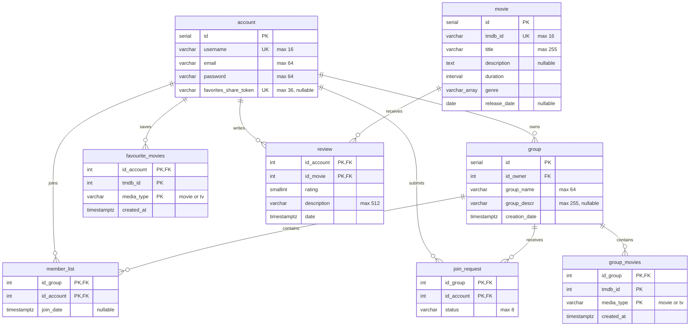
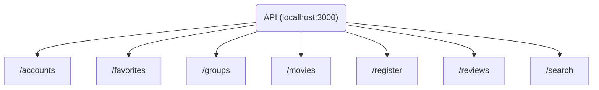
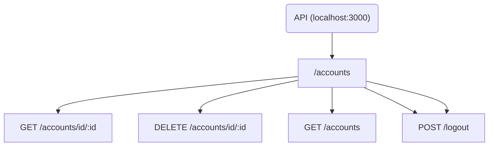
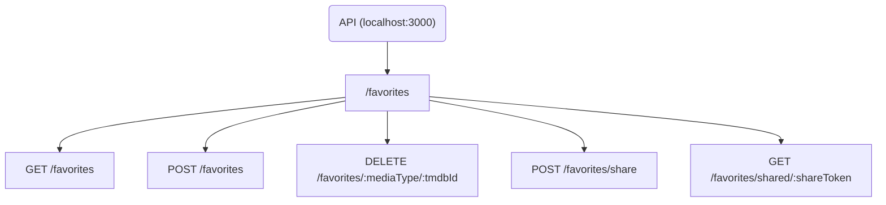
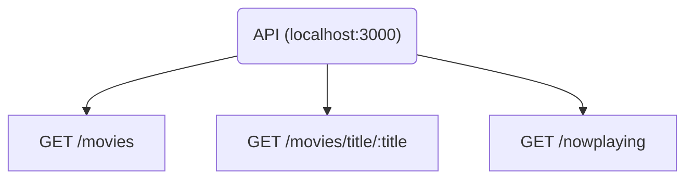

# The Red Carpet
The project assignment is to develop a website for movie enthusiasts.

The application will make use of the open-data sources mentioned later. The browser-based part of the application will be implemented using React, and the server will be built with Node. PostgreSQL will be used as the database.

The open-data API to be used is [The Movie Database](https://developer.themoviedb.org/reference/intro/getting-started), which contains a large amount of open data related to movies. Using the API requires registration, after which the necessary API key/token can be obtained.


# Tools
- Swagger
- pgAdmin
- Github:
- Visual Studio Code:
- PostgreSQL


# Documentation


## UI-Design


## Tech stack / application architecture
REST API - Node.js/Express\
Frontend - JS React\
Database - PostgreSQL

## ERD


## API

### Index


### /accounts




### /favorites




### /groups

### Get Operations
- **GET** `/groups` - Get all groups
- **GET** `/groups/id/:id` - Get group by ID
- **GET** `/groups/members/id/:id` - Get group members
- **GET** `/groups/:id/member-count` - Get member count
- **GET** `/join-requests` - Get all join requests
- **GET** `/groups/:id/join-requests` - Get join requests for specific group
- **GET** `/groups/:id/movies` - Get movies in group

### Post Operations
- **POST** `/groups` - Create new group
- **POST** `/groups/:id/movies` - Add movie to group
- **POST** `/groups/:id/join-requests` - Request to join group

### Delete Operations
- **DELETE** `/groups/id/:idgroup` - Delete group
- **DELETE** `/groups/:idgroup/leave` - Leave group
- **DELETE** `/groups/:idgroup/members/:idaccount/remove` - Remove member

### Update Operations
- **PATCH** `/groups/:idgroup/join-requests/:idaccount/approve` - Approve join request
- **PATCH** `/groups/:idgroup/join-requests/:idaccount/reject` - Reject join request


### Movie



## Parser

To scrape some data from the API you need the necessary API key and access key.
The default code will scrape 200 top rated movies from January 1st 1800 to current day.

To catch more you need to replace ``fetchMoviesFromApi({value})``.
The value represents pages, my testing resulted that around 100 pages API stream starts putting the break.

```javascript
  await fetchMoviesFromApi(10);

```


```javascript
node scripts/parser/interface.js

```


## Login requirements
- User email works as an username
- User email can be max 64 characters
- Password requirements:
    - 8-64 characters
    - Must contain one uppercase letter
    - Must contain one number
